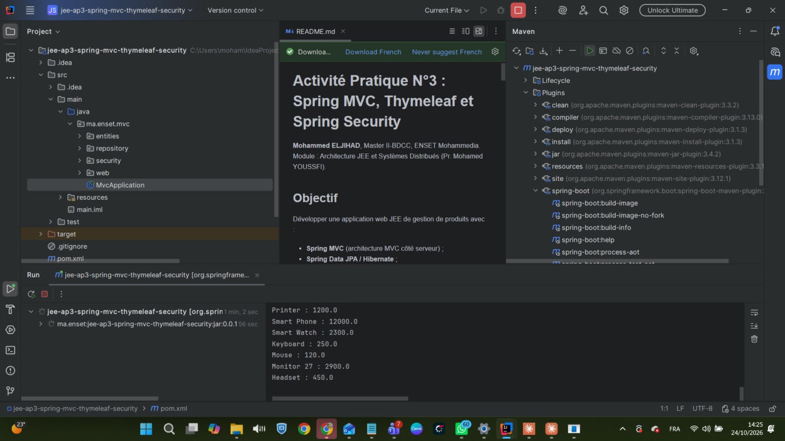
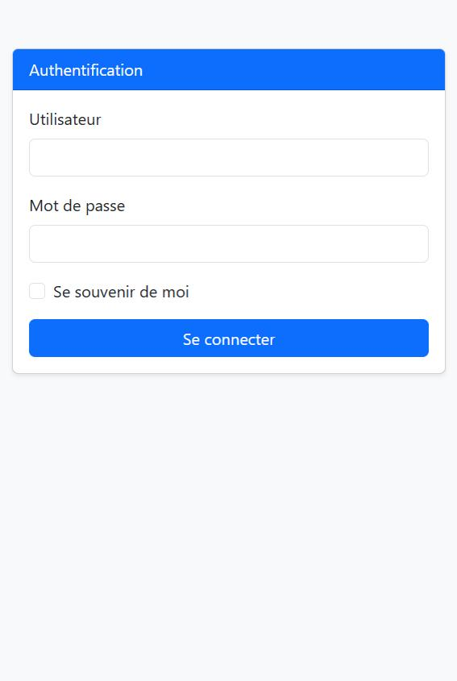
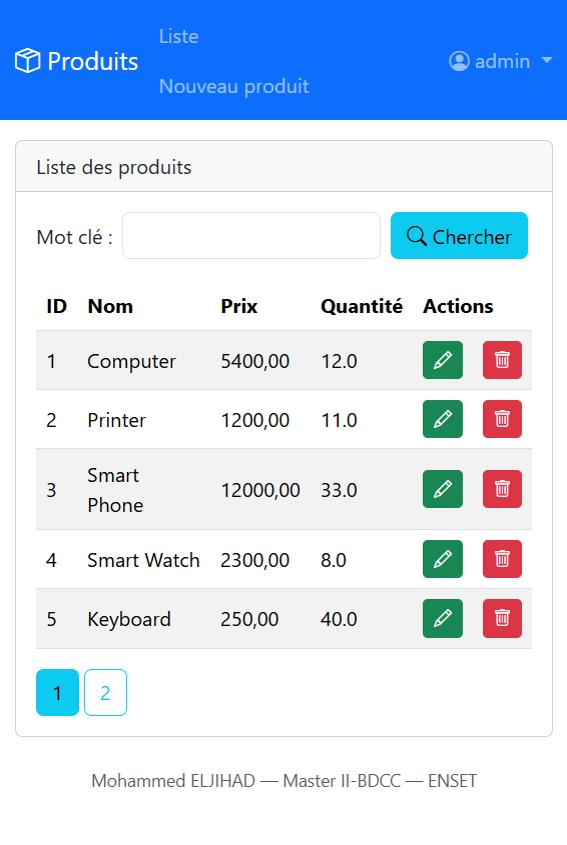
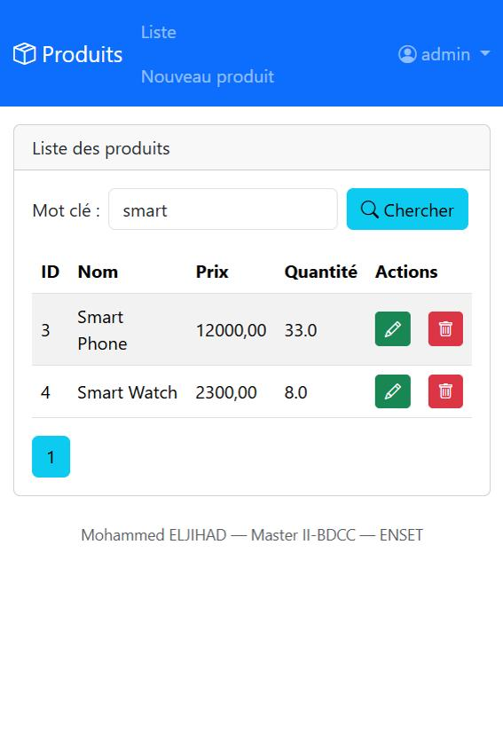
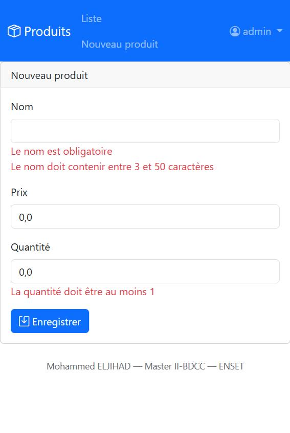
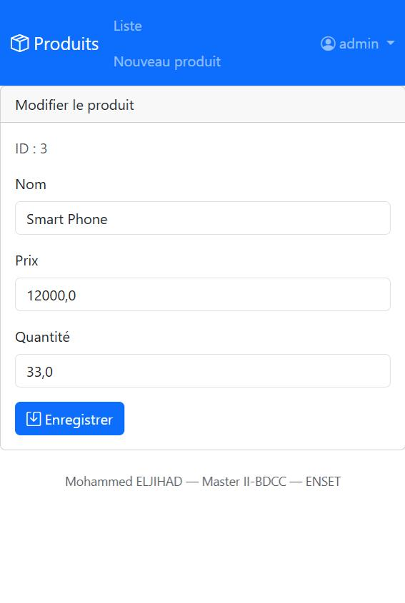
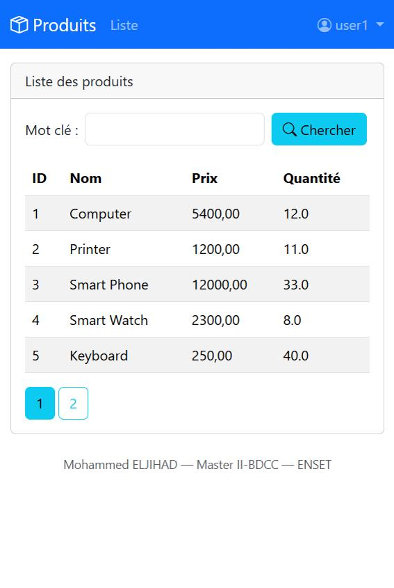
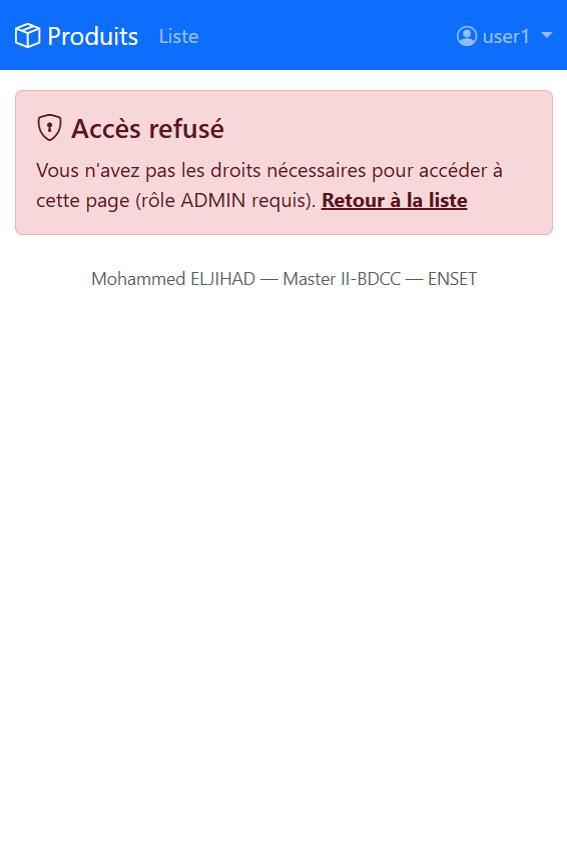

# Activité Pratique N°3 : Spring MVC, Thymeleaf et Spring Security

**Mohammed ELJIHAD**, Master II-BDCC, ENSET Mohammedia. Module : Architecture JEE et Systèmes Distribués (Pr. Mohamed YOUSSFI).

## Objectif
Développer une application web JEE de gestion de produits avec :
- **Spring MVC** (architecture MVC côté serveur) ;
- **Spring Data JPA / Hibernate** ;
- **Thymeleaf** (vues + layout dialect) et **Bootstrap** ;
- **Spring Security** (authentification et autorisation par rôles).

## Technologies
Java 17, Spring Boot 3.3, Spring Web, Spring Data JPA, H2 / MySQL, Thymeleaf + Thymeleaf Layout Dialect + thymeleaf-extras-springsecurity6, Spring Security 6, Spring Validation, Lombok, Bootstrap 5.

## Architecture
```
Navigateur ──HTTP──> DispatcherServlet ──> ProductController (@Controller)
                                              │  Model
                                              ├──> ProductRepository (Spring Data JPA) ──> H2 / MySQL
                                              └──> Vue Thymeleaf (products, new-product, edit-product, login…)
                     Spring Security (SecurityFilterChain) filtre chaque requête avant le contrôleur
```
```
src/main/java/ma/enset/mvc
├── MvcApplication.java           démarrage + données de test (CommandLineRunner)
├── entities/Product.java         entité JPA + contraintes de validation
├── repository/ProductRepository  Spring Data (recherche paginée)
├── security/SecurityConfig.java  utilisateurs, règles d'accès, page de login, remember-me
└── web/ProductController.java    contrôleur Spring MVC
src/main/resources/templates      template1 (layout), products, new-product, edit-product, login, notAuthorized
```

## Étapes réalisées

### 1. Projet Spring Boot
Dépendances : Spring Web, Spring Data JPA, H2, MySQL, Thymeleaf, Lombok, Spring Security et Spring Validation, plus `thymeleaf-layout-dialect` et `thymeleaf-extras-springsecurity6`.

### 2. Entité JPA Product (avec validation)
```java
@Entity @Data @NoArgsConstructor @AllArgsConstructor @Builder
public class Product {
    @Id @GeneratedValue(strategy = GenerationType.IDENTITY) private Long id;
    @NotEmpty @Size(min = 3, max = 50) private String name;
    @Min(0) private double price;
    @Min(1) private double quantity;
}
```

### 3. ProductRepository
```java
public interface ProductRepository extends JpaRepository<Product, Long> {
    Page<Product> findByNameContainsIgnoreCase(String keyword, Pageable pageable);
}
```

### 4. Test de la couche DAO
Le `CommandLineRunner` de `MvcApplication` insère 8 produits et les affiche dans la console au démarrage.

### 5. Désactivation de la protection par défaut
Dès que `spring-boot-starter-security` est ajouté, toutes les pages sont protégées par un formulaire de login généré et un mot de passe aléatoire. Pour développer d'abord la partie MVC, il faut désactiver cette configuration automatique :
```java
@SpringBootApplication(exclude = {SecurityAutoConfiguration.class})
```
Une fois la partie MVC terminée, l'exclusion a été retirée et remplacée par notre propre `SecurityConfig` (étape 7).

### 6. Contrôleur Spring MVC et vues Thymeleaf
| URL | Méthode | Rôle | Vue / action |
|---|---|---|---|
| `/user/index?page=&size=&keyword=` | GET | USER | `products.html` : liste paginée + recherche |
| `/admin/delete?id=` | POST | ADMIN | suppression (avec confirmation JS), retour à la même page |
| `/admin/newProduct` | GET | ADMIN | `new-product.html` : formulaire d'ajout |
| `/admin/saveProduct` | POST | ADMIN | `@Valid` + `BindingResult` : réaffiche le formulaire avec les erreurs, sinon enregistre |
| `/admin/editProduct?id=` | GET | ADMIN | `edit-product.html` : formulaire pré-rempli (mise à jour) |
| `/login`, `/notAuthorized` | GET | public | page de connexion et page 403 personnalisées |

- **Template** : `template1.html` définit la barre de navigation Bootstrap et un fragment `layout:fragment="content1"`, que chaque vue remplit avec `layout:decorate="~{template1}"`.
- **Validation** : les messages des contraintes Bean Validation s'affichent sous chaque champ avec `th:errors="*{name}"`.

### 7. Sécurisation avec Spring Security
```java
http.formLogin(form -> form.loginPage("/login").defaultSuccessUrl("/user/index", true).permitAll())
    .rememberMe(...)
    .authorizeHttpRequests(auth -> auth
        .requestMatchers("/webjars/**", "/h2-console/**").permitAll()
        .requestMatchers("/user/**").hasRole("USER")
        .requestMatchers("/admin/**").hasRole("ADMIN")
        .anyRequest().authenticated())
    .exceptionHandling(ex -> ex.accessDeniedPage("/notAuthorized"));
```
- **Utilisateurs** : `InMemoryUserDetailsManager` avec des mots de passe **BCrypt** :
  - `user1` / `1234` et `user2` / `1234` ont le rôle USER ;
  - `admin` / `1234` a les rôles USER et ADMIN.
- **Deux niveaux de contrôle** :
  - les règles sur les URL (`requestMatchers`) ;
  - la sécurité au niveau des méthodes, avec `@EnableMethodSecurity` et `@PreAuthorize("hasRole('ADMIN')")` sur les actions d'administration.
- **Côté vue**, `sec:authorize="hasRole('ADMIN')"` masque les boutons Modifier, Supprimer et Nouveau pour un simple utilisateur. `sec:authentication="name"` affiche l'utilisateur connecté.
- **Protection CSRF** : elle reste active. La suppression passe donc par un formulaire POST, qui inclut automatiquement le jeton CSRF via `th:action`.

### 8. Fonctionnalités supplémentaires
- Recherche par mot-clé, insensible à la casse.
- Pagination, en conservant le mot-clé et la page après une suppression.
- Édition et mise à jour d'un produit.
- Page d'accès refusé personnalisée.
- « Se souvenir de moi » (remember-me) et déconnexion depuis le menu utilisateur.
- Profil MySQL (`application-mysql.properties`).
- Tests MockMvc (`MvcApplicationTests`) :
  - un utilisateur anonyme est redirigé vers le login ;
  - un utilisateur USER voit la liste des produits ;
  - un utilisateur USER reçoit un 403 sur `/admin/**`.

## Exécution
```bash
mvn spring-boot:run          # http://localhost:8094  (admin / 1234 ou user1 / 1234)
mvn test                     # tests de sécurité MockMvc
mvn spring-boot:run -Dspring-boot.run.profiles=mysql
```

## Captures (exécution réelle dans IntelliJ, http://localhost:8094)
| | |
|---|---|
| Démarrage dans IntelliJ (`spring-boot:run`, données de test affichées)  | Page de connexion  |
| Liste en ADMIN (boutons Modifier/Supprimer)  | Recherche « smart »  |
| Validation du formulaire (Bean Validation)  | Édition d'un produit  |
| Liste vue par user1 (rôle USER, actions masquées)  | user1 sur `/admin/newProduct` → page « Accès refusé »  |

## Conclusion
- Spring MVC et Thymeleaf permettent de construire rapidement une application web en rendu serveur, avec des vues réutilisables grâce au layout dialect.
- Spring Security apporte une sécurité déclarative à trois niveaux : les URL, les méthodes (`@PreAuthorize`) et les vues (`sec:authorize`). Il protège aussi contre les attaques CSRF et gère le login, le logout et le remember-me.
